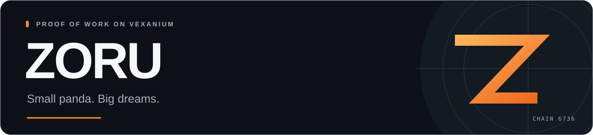

<picture>
  <source media="(prefers-color-scheme: light)" srcset="./assets/zoru-header-light.svg">
  
</picture>

  <a href="https://github.com/zoruco/zoru-miner/releases/latest"><strong>Download the miner</strong></a> &nbsp; · &nbsp;
  <a href="https://github.com/zoruco/zoru-miner/blob/main/docs/MINING.md">Start mining</a> &nbsp; · &nbsp;
  <a href="https://github.com/zoruco/zoru-pow/blob/main/docs/PROTOCOL.md">Read the rules</a> &nbsp; · &nbsp;
  <a href="https://vexascan.com/evm/address/0x1aDA50813949E9aC4631EC8383321C1D6E793aA6">View on Vexascan</a>

ZORU is a Proof-of-Work token on Vexanium. You mine with your CPU; accepted work earns ZORU. Our red panda is a reminder to stay curious, put in the work and enjoy earning your own way.

### The rules, at a glance

| Supply ceiling | Mining | Network |
| :--- | :--- | :--- |
| **42,000,000 ZORU** | **CPU · Keccak-256** | **Vexanium EVM · 6736** |

ZORU started with zero supply and no premine. The initial reward is **100 ZORU**, halving after every **210,000 paid proofs**. Reward payments are at least **600 seconds** apart. A reserved proof is counted as paid only after its reward is minted and final confirmation is verified.

The supply and halving rules are fixed in the token. The mining contracts can be upgraded by the owner while mining and minting are paused. [Read the protocol and its assumptions.](https://github.com/zoruco/zoru-pow/blob/main/docs/SECURITY.md)

### Build, mine, inspect

| Project | What you'll find |
| :--- | :--- |
| **[ZORU Miner](https://github.com/zoruco/zoru-miner)** | Desktop app and Rust CLI, wallet setup, mining instructions and software updates. |
| **[ZORU PoW](https://github.com/zoruco/zoru-pow)** | Contracts, emission rules, proof verification and local tests. |

VEX pays transaction fees. Mining rewards are not guaranteed. The [mining guide](https://github.com/zoruco/zoru-miner/blob/main/docs/MINING.md) explains the fee allowance and what each mining state means.

  
   
  <strong>Stay curious. Keep digging.</strong>
    
  <a href="mailto:zorucore@gmail.com">zorucore@gmail.com</a> &nbsp; · &nbsp;
  <a href="https://github.com/zoruco/zoru-miner/releases">Releases</a> &nbsp; · &nbsp;
  <a href="https://github.com/zoruco/zoru-miner/issues">Report an issue</a>

